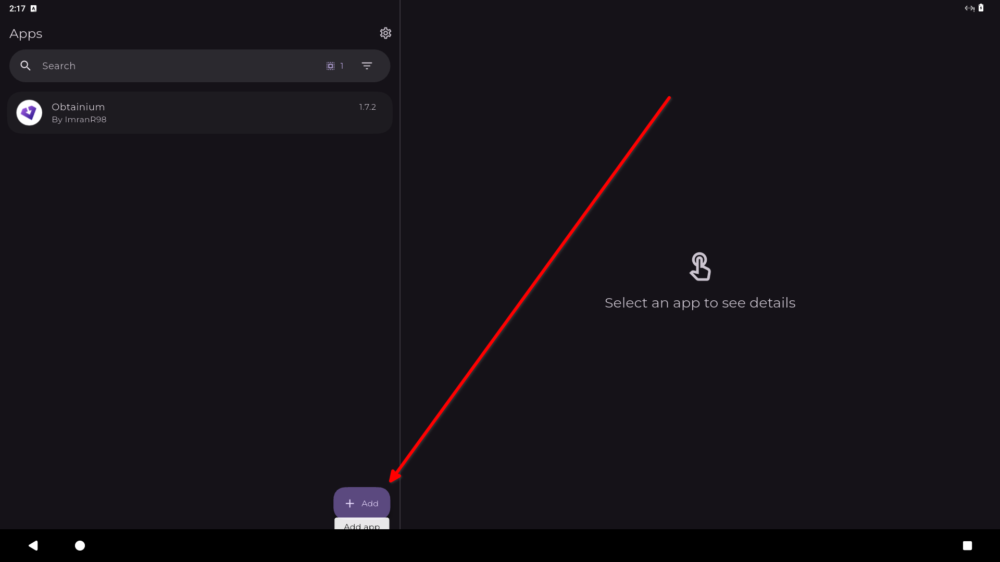
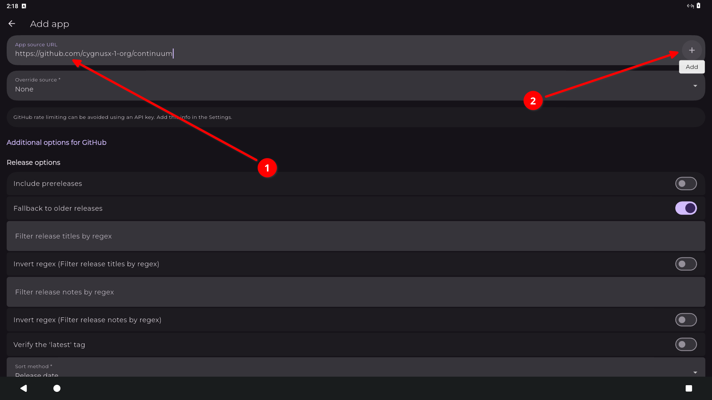
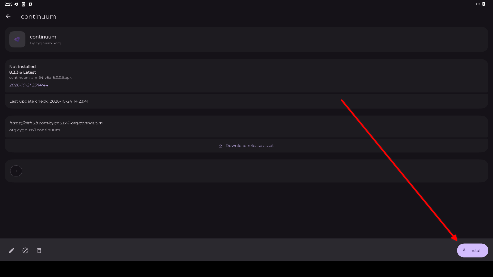
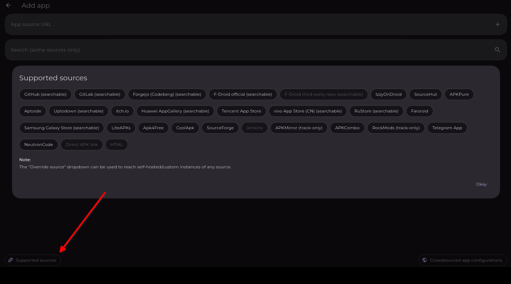

# Obtainium
[Obtainium](https://github.com/ImranR98/Obtainium) is a package manager, similar to Google Play Store, but apps are sourced from various sites mainly GitHub, GitLab, Codeberg, etc.. This allows you to get auto updates directly from the developer.

[Direct download link here](https://github.com/ImranR98/Obtainium/releases/latest/download/app-release.apk)

## Complex Apps Repo
- For complex apps to add to Obtainium

https://apps.obtainium.imranr.dev/

## Adding GitHub Apps through URL
1. Open Obtainium
2. Tap the add button

3. Add URL in "App source URL" (see 1 in picture), then the plus icon (see 2 in picture)

4. Finally tap the install button

    - First install Android will prompt to allow obtainium to install unkown apps, allow this

    
Other sources info

    Although this write up only shows GitHub URLs being used, other services are supported by obtainium. A list can be seen in the bottom left of the add screen.
    

